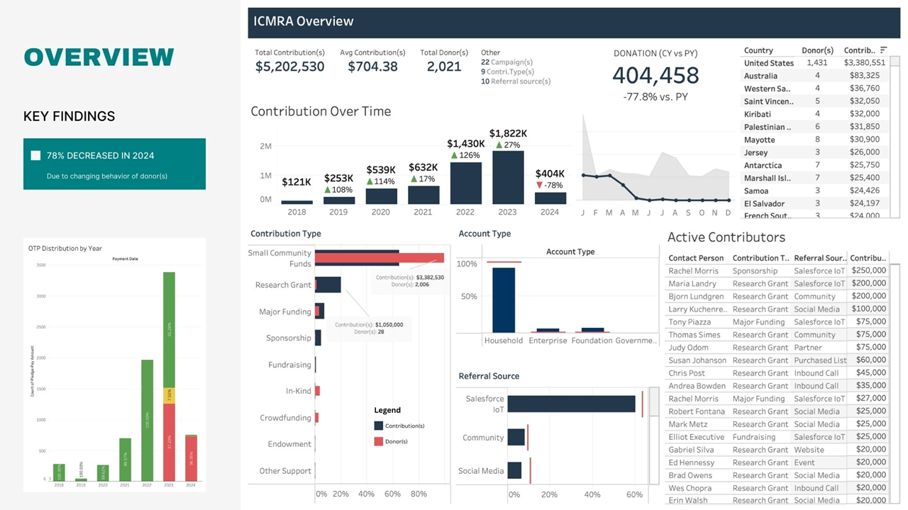
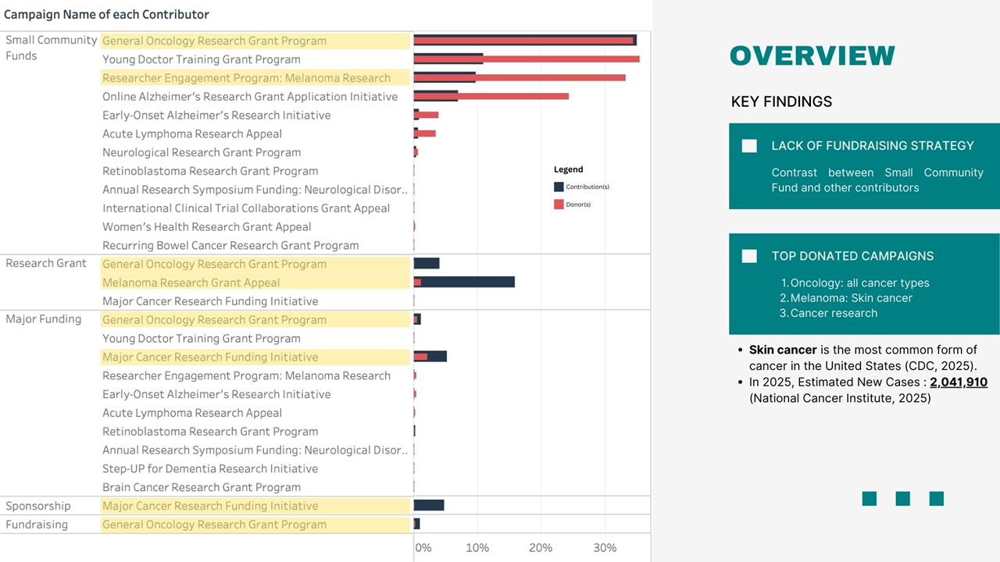
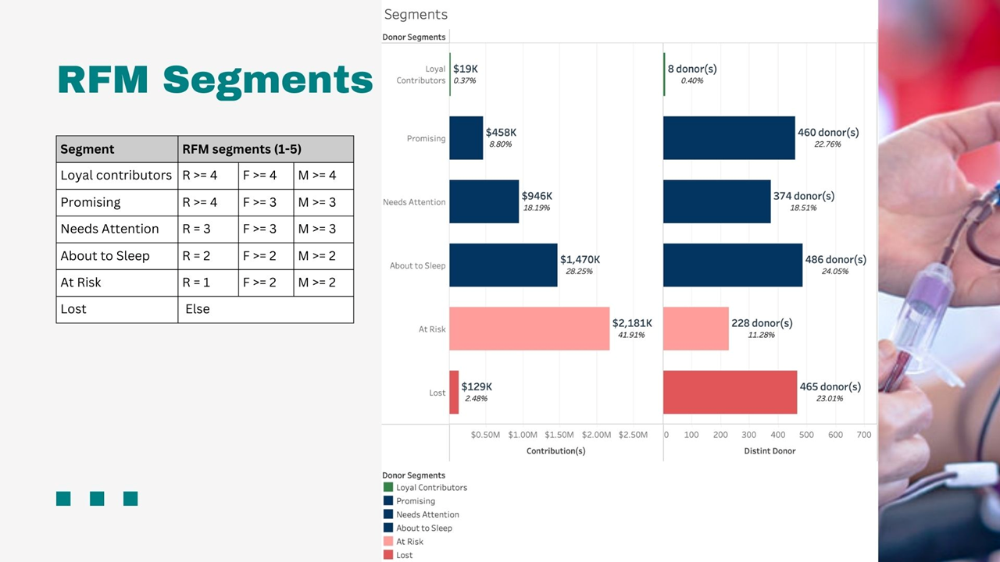
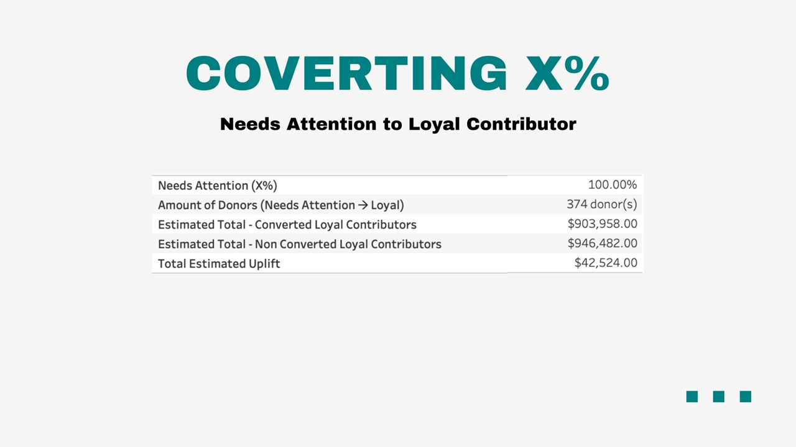
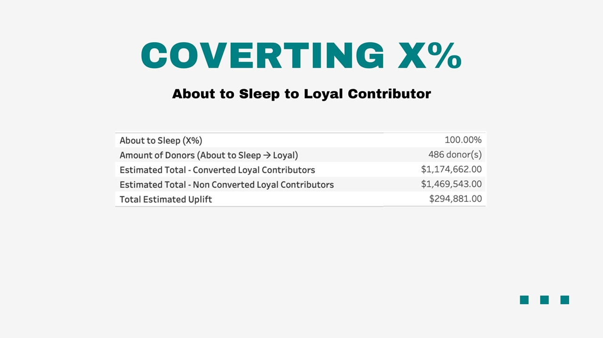
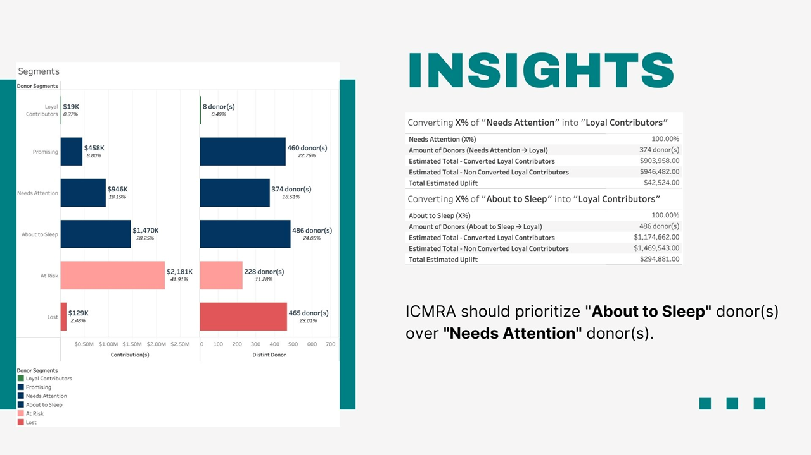

# Fundraising Performance & Donor Retention Analysis
## Case study of ICMRA

Analyzed donor contribution data to identify key drivers affecting fundraising performance, donor retention, campaign effectiveness, and contributor engagement. The project focused on transforming raw fundraising data into actionable business insights through data cleaning, segmentation analysis, predictive scenario modeling, and interactive Tableau visualizations.

- **Dataset Size:** 103,418 donor records / $5.2M in contributions 
- **Industry:** Non-Profit / Medical Research Fundraising 
- **Analysis Areas:** Data Quality, Donor Retention, Churn Analysis, Campaign Performance, RFM Segmentation 
- **Tools Used:** Tableau, Tableau Prep Builder 
- **Data Source:** ICMRA Fundraising Dataset (2018-2024) 

